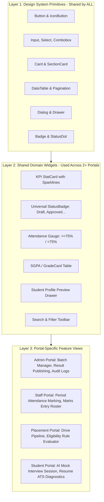
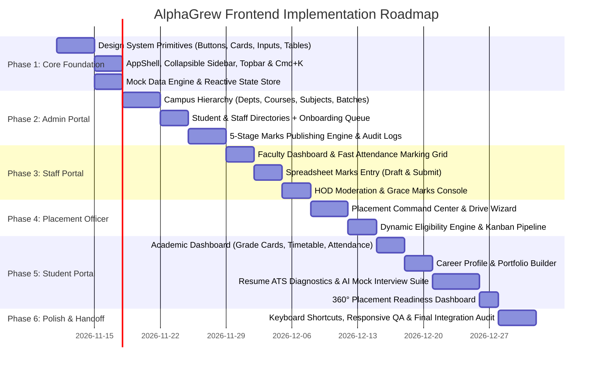

# ALPHAGREW — Premium Frontend Architecture & Development Blueprint
> **System**: Enterprise Multi-Tenant Campus ERP, Academic Results & AI Placement Intelligence Platform  
> **Document**: Complete Engineering Blueprint & Specification for the Brand-New Frontend  
> **Target Technology**: React 19 · TypeScript 5.8+ · Vite 6 · Tailwind CSS 4 · React Router 7 · TanStack Query 5  
> **Design Philosophy**: High-performance, clean, sophisticated enterprise interface inspired by Linear, Stripe, and modern B2B SaaS benchmarks.  
> **Status**: Ready for Implementation (Awaiting Architectural Approval)  
> **Date**: November 2026

---

## 1. Executive Summary & Design Vision

AlphaGrew is a modern multi-tenant Campus ERP and AI-driven career acceleration ecosystem. It bridges institutional operations (admissions, academic hierarchies, faculty scheduling, daily attendance, examination moderation, and publishing) with student self-service (degree progress, transcripts, grade cards) and career intelligence (resume ATS diagnostics, adaptive AI mock interviews, and placement drives).

This document specifies the architecture, component taxonomy, design system tokens, screen flows, mock data strategy, and execution roadmap for building a **completely new, ground-up frontend**. 

### 1.1 Visual Direction & Brand Identity (Linear / Stripe Benchmark)
The interface departs from dated academic legacy portals in favor of a crisp, focused, keyboard-friendly enterprise workspace:
- **Calm, High-Contrast Surfaces**: Deep slate/zinc dark modes and immaculate neutral light modes with subtle 1px border separation (`border-slate-200/80` / `border-zinc-800/80`), translucent backdrop blurs (`backdrop-blur-md`), and eliminated visual clutter.
- **Micro-Delight & Kinetic Polish**: Spring physics for modals, sliding segmented controls, smooth accordion expansions, and interactive hover rings using Tailwind 4 utility tokens.
- **Typography First**: Clean geometric typography stack (Geist / Inter / system font fallback) with tabular numerals for marks, GPAs, percentages, and currencies; clear optical hierarchy with snug line heights and tightened letter tracking (`tracking-tight`).
- **Dense Yet Readable Layouts**: Information-dense tables with configurable cell padding, inline status pills, badge dots, sticky headers, contextual action bars, and slide-over drawers (Master-Detail) rather than disruptive page jumps.
- **Accessible, Human Data Displays**: State indicators (Draft, Submitted, Verified, Approved, Published, Locked) designed with distinct iconography and WCAG AAA-compliant color pairings.

---

## 2. Recommended Project Folder Structure

A modular, **feature-first / domain-driven architecture** separating shared UI primitives, shared domain widgets, mock services, and portal-specific page trees.

```
alphagrew-frontend/
├── index.html
├── package.json
├── tsconfig.json
├── vite.config.ts
├── tailwind.config.js / globals.css       # Tailwind CSS 4 core configuration
├── public/
│   ├── favicon.svg
│   ├── brand/                             # AlphaGrew logos, tenant default assets
│   └── mock-assets/                       # Sample resumes, sample avatar headshots
└── src/
    ├── app/                               # Application Core
    │   ├── main.tsx                       # React 19 root bootstrap
    │   ├── App.tsx                        # Router provider & TanStack Query setup
    │   ├── routes.tsx                     # React Router 7 route definitions & guards
    │   └── providers.tsx                  # Compound providers (Query, Theme, Auth, Toast)
    │
    ├── assets/                            # Static SVG icons, illustrations, badges
    │
    ├── design-system/                     # Linear/Stripe-Inspired UI Primitives (Atomic)
    │   ├── tokens/                        # Colors, typography, shadows, animations
    │   ├── components/
    │   │   ├── button/                    # Button, IconButton, ButtonGroup
    │   │   ├── input/                     # TextInput, NumberInput, PasswordInput, SearchInput
    │   │   ├── select/                    # Select, Combobox, MultiSelect
    │   │   ├── card/                      # Card, MetricCard, ActionCard, SectionCard
    │   │   ├── badge/                     # Badge, StatusDot, Pill, Tag
    │   │   ├── table/                     # DataTable, TableHeader, TableRow, Pagination
    │   │   ├── modal/                     # Dialog, ConfirmModal, SlideOverDrawer
    │   │   ├── dropdown/                  # DropdownMenu, ContextMenu
    │   │   ├── tabs/                      # SegmentedControl, UnderlineTabs, PillTabs
    │   │   ├── feedback/                  # Toast, Alert, Skeleton, Spinner, EmptyState
    │   │   ├── tooltip/                   # Tooltip, Popover
    │   │   └── command-menu/              # Global Cmd+K Command Palette
    │   └── index.ts                       # Public design system export barrel
    │
    ├── components/                        # Shared Domain Components (Cross-Portal)
    │   ├── layout/
    │   │   ├── AppShell.tsx               # Master portal layout container
    │   │   ├── Sidebar.tsx                # Collapsible, grouped sidebar
    │   │   ├── Topbar.tsx                 # Breadcrumbs, tenant switcher, user profile
    │   │   ├── PageHeader.tsx             # Standardized title, subtitle, action buttons
    │   │   ├── MobileNav.tsx              # Sheet navigation for small screens
    │   │   └── ContentContainer.tsx       # Max-width & padding consistency wrapper
    │   ├── data-display/
    │   │   ├── StatCard.tsx               # KPI stat with trend pill and sparkline
    │   │   ├── StatusBadge.tsx            # Universal status badge (Draft, Published, etc.)
    │   │   ├── AttendanceGauge.tsx        # Circular / progress bar attendance indicator (<75% alert)
    │   │   ├── GradeCard.tsx              # University SGPA/CGPA grade breakdown
    │   │   ├── CandidateDrawer.tsx        # Slide-over profile preview for TPO/Staff
    │   │   └── FilterToolbar.tsx          # Search + multi-select filter chip bar
    │   └── common/
    │       ├── ErrorBoundary.tsx
    │       ├── NotFoundView.tsx
    │       ├── AccessDeniedView.tsx
    │       └── LoadingScreen.tsx
    │
    ├── features/                          # Domain Features (Business Logic + Slices)
    │   ├── auth/                          # Authentication, Password Reset, Invitations
    │   ├── academics/                     # Departments, Courses, Semesters, Subjects
    │   ├── attendance/                    # Roster marking, HOD approval, student views
    │   ├── marks/                         # 5-Stage Moderation, Entry, Publishing Engine
    │   ├── placement/                     # Company Drives, Eligibility, Applications
    │   ├── student-hub/                   # Career Profile, Portfolio, Resumes
    │   ├── ai-interview/                  # Mock Interview Session, Turns, Evaluation
    │   └── administration/                # Batches, Designations, Audit Logs, Settings
    │
    ├── portals/                           # Portal-Wise Screen Views (Thin View Controllers)
    │   ├── admin/                         # 1. Institution Admin & Super Admin Views
    │   │   ├── DashboardOverview.tsx
    │   │   ├── DepartmentsPage.tsx
    │   │   ├── CoursesSubjectsPage.tsx
    │   │   ├── BatchesClassesPage.tsx
    │   │   ├── StaffDirectoryPage.tsx
    │   │   ├── StudentDirectoryPage.tsx
    │   │   ├── OnboardingApprovalsPage.tsx
    │   │   ├── MarksManagementPage.tsx
    │   │   ├── PlacementOversightPage.tsx
    │   │   ├── FeesFinancePage.tsx
    │   │   ├── SystemSettingsPage.tsx
    │   │   └── AuditLogsPage.tsx
    │   ├── staff/                         # 2. Staff / Faculty Portal Views
    │   │   ├── FacultyDashboard.tsx
    │   │   ├── SubjectAllocationsPage.tsx
    │   │   ├── AttendanceMarkingPage.tsx
    │   │   ├── MarksEntryPage.tsx
    │   │   ├── HODReviewQueuePage.tsx
    │   │   ├── HODWorkloadPage.tsx
    │   │   └── DepartmentAnalyticsPage.tsx
    │   ├── placement/                     # 3. Placement Officer (TPO) Views
    │   │   ├── PlacementDashboard.tsx
    │   │   ├── CompanyDrivesPage.tsx
    │   │   ├── DriveDetailPage.tsx
    │   │   ├── StudentEligibilityPage.tsx
    │   │   ├── ApplicationsKanbanPage.tsx
    │   │   ├── PlacementReportsPage.tsx
    │   │   └── PolicySettingsPage.tsx
    │   └── student/                       # 4. Student Portal Views
    │       ├── StudentDashboard.tsx
    │       ├── AcademicProgressPage.tsx   # Grade cards, SGPA, attendance
    │       ├── ClassTimetablePage.tsx
    │       ├── StudyMaterialsPage.tsx
    │       ├── PlacementDrivesPage.tsx    # Available drives & 1-click apply
    │       ├── CareerProfilePage.tsx      # Projects, experience, skills
    │       ├── ResumeOptimizerPage.tsx    # Resume upload & ATS breakdown
    │       ├── AiInterviewHubPage.tsx     # Mock interview setup & history
    │       ├── AiInterviewSessionPage.tsx # Turn-by-turn interactive voice/text session
    │       └── ReadinessScorePage.tsx     # 360° Career Readiness breakdown
    │
    ├── services/                          # Integration-Ready Service Layer
    │   ├── api/                           # Typed API interfaces matching Laravel DTOs
    │   ├── mock/                          # High-Fidelity Mock Implementations
    │   │   ├── mockDb.ts                  # In-memory reactive state seed
    │   │   ├── mockAuthService.ts
    │   │   ├── mockAcademicsService.ts
    │   │   ├── mockMarksService.ts
    │   │   ├── mockAttendanceService.ts
    │   │   ├── mockPlacementService.ts
    │   │   └── mockAiService.ts
    │   └── index.ts                       # Dynamic service resolver (mock vs. real API)
    │
    ├── hooks/                             # Custom React Hooks
    │   ├── useAuth.ts                     # User identity, portal context, login/logout
    │   ├── usePermissions.ts              # Fine-grained capability checks
    │   ├── useTenant.ts                   # Current institution, campus, branding
    │   ├── useCommandMenu.ts              # Cmd+K keyboard shortcut registration
    │   └── useDebounce.ts
    │
    ├── types/                             # TypeScript Contracts
    │   ├── auth.types.ts
    │   ├── tenant.types.ts
    │   ├── academic.types.ts
    │   ├── marks.types.ts
    │   ├── placement.types.ts
    │   ├── interview.types.ts
    │   └── common.types.ts
    │
    └── utils/                             # Utilities
        ├── cn.ts                          # clsx + tailwind-merge helper
        ├── formatters.ts                  # Currency, percentages, GPA, date/time
        └── constants.ts                   # Role labels, navigation definitions
```

---

## 3. Design System & Visual Specification

Inspired by **Linear's meticulous monochrome clarity** and **Stripe's clean data typography**, the design system delivers an understated, distraction-free environment.

### 3.1 Color Palette & Semantic Tokens

```
Surface Backgrounds:
  • Canvas Root:         #090A0F (Dark)   |  #F8FAFC (Light / Slate-50)
  • Surface Primary:     #11131A (Dark)   |  #FFFFFF (Light)
  • Surface Secondary:   #181B24 (Dark)   |  #F1F5F9 (Light / Slate-100)
  • Surface Tertiary:    #202430 (Dark)   |  #E2E8F0 (Light / Slate-200)

Borders & Dividers:
  • Border Subtlest:     rgba(255, 255, 255, 0.06) |  #E2E8F0 (Slate-200)
  • Border Default:      rgba(255, 255, 255, 0.12) |  #CBD5E1 (Slate-300)
  • Border Strong:       rgba(255, 255, 255, 0.20) |  #94A3B8 (Slate-400)
  • Ring / Focus:        #6366F1 (Indigo-500)       |  #4F46E5 (Indigo-600)

Brand Accent & Action:
  • Primary / Accent:    #6366F1 (Linear Indigo)    |  #4F46E5 (Indigo-600)
  • Primary Hover:       #4F46E5 (Indigo-600)       |  #4338CA (Indigo-700)
  • Primary Subtle:      rgba(99, 102, 241, 0.12)   |  #EEF2FF (Indigo-50)

Semantic Status Palette:
  • Success (Approved / Published / Placed / >75% Att.):
      Base: #10B981 (Emerald-500)   · Background: rgba(16, 185, 129, 0.10) · Border: rgba(16, 185, 129, 0.25)
  • Warning (Draft / In Review / Moderation / 65-75% Att.):
      Base: #F59E0B (Amber-500)     · Background: rgba(245, 158, 11, 0.10)  · Border: rgba(245, 158, 11, 0.25)
  • Danger / Destructive (Rejected / Failed / Debarred / <65% Att.):
      Base: #EF4444 (Rose-500)      · Background: rgba(239, 68, 68, 0.10)   · Border: rgba(239, 68, 68, 0.25)
  • Info / Neutral (Submitted / Upcoming Drive / Processing):
      Base: #0EA5E9 (Sky-500)       · Background: rgba(14, 165, 233, 0.10)  · Border: rgba(14, 165, 233, 0.25)
  • AI Magic (Mock Interview / ATS Diagnostics / Recommendations):
      Base: #8B5CF6 (Purple-500)    · Gradient: from-indigo-500 via-purple-500 to-pink-500
```

### 3.2 Typography Hierarchy

- **Font Family**: `Geist Sans`, `Inter`, `-apple-system`, `BlinkMacSystemFont`, `Segoe UI`, `Roboto`, `sans-serif`.
- **Monospace Family (for Numbers, GPA, Roll Numbers, Codes)**: `Geist Mono`, `JetBrains Mono`, `Fira Code`, monospace.

| Token | Size | Line Height | Weight | Letter Spacing | Usage Example |
|---|---|---|---|---|---|
| `text-display` | 28px (1.75rem) | 34px | SemiBold (600) | `-0.025em` | Portal landing title, Career Readiness score |
| `text-title-lg`| 22px (1.375rem)| 28px | SemiBold (600) | `-0.02em` | Section headers, Drawer titles |
| `text-title-md`| 18px (1.125rem)| 24px | Medium (500) | `-0.015em` | Card headers, Modal titles |
| `text-body-md` | 14px (0.875rem)| 20px | Regular (400) | `normal` | Standard paragraph text, table body cells |
| `text-body-sm` | 13px (0.8125rem)| 18px | Regular (400) | `normal` | Secondary meta, helper descriptions |
| `text-caption` | 11px (0.6875rem)| 15px | Medium (500) | `+0.02em` | Upper-case section labels, table column headers |
| `text-mono-md` | 13px (0.8125rem)| 18px | Medium (500) | `normal` | Marks input, SGPA values, Roll Numbers |

### 3.3 Micro-Interactions, Elevation & Spacing Tokens
- **Borders**: Universal 1px fine hairline borders (`border border-slate-200/70 dark:border-zinc-800/80`).
- **Shadows**:
  - `shadow-xs`: `0 1px 2px 0 rgba(0, 0, 0, 0.05)` (Standard card, input default)
  - `shadow-sm`: `0 1px 3px 0 rgba(0, 0, 0, 0.08), 0 1px 2px -1px rgba(0, 0, 0, 0.08)` (Dropdown menus, popovers)
  - `shadow-lg`: `0 12px 24px -4px rgba(0, 0, 0, 0.12), 0 4px 6px -2px rgba(0, 0, 0, 0.04)` (Modals, Command Menu)
- **Border Radius**:
  - `rounded-lg`: 8px (Buttons, input fields, badges)
  - `rounded-xl`: 12px (Cards, modal dialogs, drawers)
  - `rounded-2xl`: 16px (Primary dashboard metric panels)
- **Transitions**: `transition-all duration-150 ease-out` for hover states and button presses (`active:scale-[0.98]`).

---

## 4. Shared vs. Portal-Specific Component Architecture

To prevent code duplication while respecting portal uniqueness, all UI components are strictly cataloged into **Shared Primitives**, **Shared Domain Widgets**, or **Portal-Specific Screens**.



### Component Taxonomy Matrix

| Component Name | Category | Scope | Reused In Portals | Description & Capabilities |
|---|---|---|---|---|
| `Button` / `IconButton` | Primitive | **Universal** | All 4 Portals | Supports `primary`, `secondary`, `outline`, `ghost`, `destructive`, and `magic` (AI purple gradient). Includes loading spinner. |
| `DataTable` | Primitive | **Universal** | All 4 Portals | Virtualized / paginated tabular component with column sorting, checkbox selection, row click, and empty state. |
| `SlideOverDrawer` | Primitive | **Universal** | All 4 Portals | Right-anchored sliding sheet with backdrop blur. Used for detail inspection without leaving the page. |
| `StatCard` | Domain Widget | **Shared** | All 4 Portals | Shows primary numeric metric, percentage delta, micro sparkline chart, and optional tooltip. |
| `StatusBadge` | Domain Widget | **Shared** | All 4 Portals | Maps states (`draft`, `submitted`, `verified`, `approved`, `published`, `locked`, `placed`) to standardized visual tokens. |
| `AttendanceGauge` | Domain Widget | **Shared** | Admin, Staff, Student | Visual percentage dial or bar. Automatically applies warning threshold logic (`< 75%` amber/red). |
| `GradeCard` | Domain Widget | **Shared** | Admin, Student | Standardized course credit, letter grade, and SGPA calculation card. |
| `CandidateDrawer` | Domain Widget | **Shared** | Admin, Staff, Placement | Inspects full student resume, skills, verified prior education, and CGPA from any table. |
| `FilterToolbar` | Domain Widget | **Shared** | All 4 Portals | Search input + categorical chips + date pickers with active filter counter and reset button. |
| `MarksEntryGrid` | Feature UI | **Portal-Specific** | Staff | High-density keyboard-navigable grid for faculty to type internal/external marks with Tab/Enter key advancement. |
| `MarksReviewConsole` | Feature UI | **Portal-Specific** | Staff (HOD), Admin | Moderation panel with side-by-side mark comparisons, grace mark adjustments, and bulk verification. |
| `PublishingReadinessCard`| Feature UI | **Portal-Specific** | Admin | Checks if 100% of semester subjects are approved before unlocking the "Publish Semester Results" button. |
| `DriveKanbanBoard` | Feature UI | **Portal-Specific** | Placement Officer | Multi-column pipeline tracking students across drive stages (Applied $\rightarrow$ Aptitude $\rightarrow$ Interview $\rightarrow$ Offered). |
| `EligibilityRuleBuilder`| Feature UI | **Portal-Specific** | Placement Officer | Interactive rule builder (Min CGPA, Max Backlogs, Allowed Batches, Allowed Departments). |
| `InterviewChatInterface`| Feature UI | **Portal-Specific** | Student | Conversational turn-based audio/text interview console with wave audio visualizer and adaptive question prompts. |
| `ResumeAtsGauge` | Feature UI | **Portal-Specific** | Student | Score breakdown (0-100), missing keywords, action-verb density, and section completeness. |
| `ReadinessRadarChart` | Feature UI | **Portal-Specific** | Student | 360° radar visual (Academics 25%, Profile 20%, Interview 35%, Resume 20%). |

---

## 5. Portal-Wise Page & Screen Architecture

### 5.1 Portal 1: Institution Admin & Super Admin Portal

The administrative nerve center for institutional configuration, academic lifecycle control, and compliance.

```
/admin
├── /dashboard                    # Executive Institutional Pulse (Enrolled, Staff, Placed %, Active Drives)
├── /organization
│   ├── /campuses                 # Physical Campuses & Sites
│   ├── /departments              # Academic Departments (Intake, HOD assignment, staff count)
│   ├── /courses                  # Degree Programs (B.Tech, M.Tech, MCA) & Semesters
│   └── /subjects                 # Subject Registry, Credit parameters, Elective groupings
├── /cohorts
│   ├── /batches                  # Student Cohorts (e.g., 2022-2026 Batch) & Class Sections
│   └── /academic-years           # Academic Calendar Terms & Current Active Semester
├── /people
│   ├── /students                 # Master Student Directory (Filter by Dept, Batch, Status, Fee Dues)
│   ├── /staff                    # Faculty & Staff Directory (Workload, Designation, Contact)
│   └── /onboarding               # Email Invitations & Self-Registration Approval Queue
├── /academics
│   ├── /attendance-audit         # Campus-wide Attendance Compliance Overview
│   └── /marks-engine             # The 5-Stage Result Publishing Control Center
│       ├── /scales-schemes       # Grade Rules (O, A+, B) & Mark Schemes (Internal/External split)
│       ├── /review-queue         # Verification queue across all departments
│       ├── /publishing           # Semester SGPA calculation & Result Locking
│       └── /audit-logs           # Result Publishing & Rollback Unlock Ledger
├── /placement-oversight          # Institutional Placement Policies (One-offer rule, Dream offer rules)
├── /finance                      # Fee Structures, Student Dues, Payment Collection Records
└── /system
    ├── /branding                 # Institution Name, Domain, Logo Upload, Address
    ├── /roles-permissions        # Dynamic Spatie Permission Matrix for Staff Designations
    └── /audit-logs               # Immutable System Activity Log (Actor, Action, Diff, IP)
```

#### Key Screen Highlights:
- **Marks Publishing Control Center**: Visual checklist of all subjects in a semester. Displays whether each subject is in `approved` status. Provides single-click `Publish Semester Results` (calculates SGPA and locks records) with a safe, reason-mandated `Unlock Results` rollback modal.
- **Onboarding & Approval Hub**: Two-tab interface:
  1. *Invitations*: Send batch invitations via email with designated roles and expiration countdowns.
  2. *Registration Queue*: Student self-registration queue with instant one-click `Approve` or `Reject` (with feedback reason).

---

### 5.2 Portal 2: Staff / Faculty Portal

Focused on instructional workflows: roster management, daily period attendance, mark entry, and departmental moderation.

```
/staff
├── /dashboard                    # Today's Lecture Schedule, Allocated Subjects, Pending Actions
├── /attendance
│   ├── /mark-attendance          # Class & Subject Attendance Marking Roster
│   └── /attendance-history       # Historical Attendance Register & Date Range Search
├── /marks-management
│   ├── /roster-entry             # High-speed Keyboard Mark Entry (Draft & Submit)
│   └── /submission-history       # Status tracker for submitted subject rosters
├── /hod-console (Rendered if user holds HOD Designation)
│   ├── /moderation-queue         # Departmental Marks Verification & Grace Marks allocation
│   ├── /faculty-workload         # Subject allocations across departmental teachers
│   └── /department-analytics     # Department pass rates, GPA distributions, attendance risks
├── /announcements                # Departmental and Campus Bulletins
└── /profile-settings             # Faculty Specialization, Biometric ID, Contact Details
```

#### Key Screen Highlights:
- **Fast Attendance Marking Grid**: Displays enrolled students with quick-toggle buttons: `Present` (Default Green), `Absent` (Red), `Late` (Amber). One-click "Mark All Present" button.
- **Keyboard-Optimized Marks Entry Grid**: Spreadsheet-like input grid. Faculty can enter Internal and External marks within scheme limits. Live calculation of Total, Result (Pass/Fail), and Grade. Supports `Save Draft` (iterative) and `Submit for Review`.

---

### 5.3 Portal 3: Placement Officer (TPO) Portal

A high-powered corporate recruitment and career pipeline management interface.

```
/placement
├── /dashboard                    # Placement Command Center (Funnel KPIs, Highest CTC, Placed %)
├── /drives
│   ├── /all-drives               # Corporate Placement Drives (Active, Upcoming, Completed)
│   ├── /create-drive             # Multi-step Drive Wizard (Company, Role, Package, Dates)
│   └── /drive-detail/:id         # Single Drive Command: Eligible Roster, Rounds, Shortlists
├── /eligibility-engine           # Dynamic Eligibility Filter (Min CGPA, Backlog limits, Depts)
├── /applications-pipeline        # Interactive Kanban / Table of Student Applications
├── /batch-performance            # Historical Batch Comparison (Placed vs. Unplaced, Salary curves)
├── /reports-export               # One-click CSV/PDF Placement Compliance & Accreditation Reports
└── /placement-policy             # Institutional Rules (One-student-one-job, Dream offer policy)
```

#### Key Screen Highlights:
- **Interactive Drive Command Center**: Displays company logo, role description, CTC breakdown, drive dates, and eligible pool size. Includes a round-by-round tracker (Aptitude $\rightarrow$ Technical Round 1 $\rightarrow$ Technical Round 2 $\rightarrow$ HR $\rightarrow$ Selected).
- **Dynamic Eligibility Evaluator**: Allows TPO to filter real-time candidate pools (e.g., `CGPA >= 7.5 AND Active Backlogs == 0 AND Department IN [CSE, IT]`). Exports filtered lists directly into drive rosters.

---

### 5.4 Portal 4: Student Portal & AI Career Hub

A unified student experience combining academic self-service with career intelligence and AI interview practice.

```
/student
├── /dashboard                    # Academic GPA, Attendance Alert Pill, Next Class, Live Drives
├── /academics
│   ├── /timetable                # Weekly Class & Lab Schedule
│   ├── /attendance               # Subject Attendance Breakdown with Shortfall Warnings (<75%)
│   ├── /materials                # Lecture Slides, Syllabus, and Assignment Downloads
│   └── /results                  # Official Published Grade Cards, SGPA history & Backlogs
├── /career-hub                   # THE STUDENT CAREER INTELLIGENCE PLATFORM
│   ├── /profile                  # Career Profile Builder (Headline, About, Socials, Relocation)
│   ├── /portfolio                # Projects, Internships, Experience, Verified Education
│   ├── /skills                   # Self-rated & Verified Technical/Soft Skills Matrix
│   ├── /resume-optimizer         # Resume Upload, PDF Preview, AI ATS Diagnostic Score (0-100)
│   ├── /ai-interviewer           # AI Mock Interview Studio
│   │   ├── /setup                # Role, Mode (Technical/HR/Mixed), Difficulty, Time Limit
│   │   ├── /session/:id          # Interactive Session (Turn-by-turn Audio/Text, Adaptive Follow-ups)
│   │   ├── /evaluations          # Holistic Evaluation Scorecard & Turn-by-Turn Critiques
│   │   └── /skill-gap            # Target Role Match % & Missing Competencies
│   └── /readiness-center         # 360° Placement Readiness Dashboard & AI Action Recommendations
└── /placement-drives             # Eligible Company Drives & 1-Click Job Applications
```

#### Key Screen Highlights:
- **AI Mock Interview Studio**: Minimalist, distraction-free conversational interface inspired by Linear and modern AI chat applications. Features animated audio waveform visualizer during speech input, clean turn transcript, and immediate post-interview analysis.
- **360° Placement Readiness Center**: Visual breakdown showing holistic score:
  - Profile Completeness (20%)
  - Academic Standing / CGPA (25%)
  - AI Mock Interview Performance (35%)
  - Resume ATS Quality (20%)
  - Prioritized actionable cards (e.g., "Review SQL Indexing & Joins", "Add GitHub repository link to portfolio").

---

## 6. Navigation Structure for Each User Role

The navigation follows **Linear's collapsible sidebar paradigm**, with a tenant workspace switcher at the top, logical module groups, real-time status badges, and a user profile menu at the bottom.

```
┌─────────────────────────────────────────────────────────────┐
│  [Logo] AlphaGrew · Demo University                   [ ▾ ] │  <- Workspace / Tenant Header
├─────────────────────────────────────────────────────────────┤
│  🔍 Search or jump to...                         Cmd + K   │  <- Command Palette Trigger
├─────────────────────────────────────────────────────────────┤
│  OVERVIEW                                                   │
│  📊 Dashboard                                               │
│  📢 Announcements                                       [2] │
├─────────────────────────────────────────────────────────────┤
│  ACADEMICS                                                  │
│  🏛️  Departments                                            │
│  📚 Courses & Subjects                                      │
│  👥 Batches & Cohorts                                       │
│  🕒 Timetable                                               │
│  ⏱️  Attendance                                              │
│  📈 Marks & Publishing Engine                          [!]  │  <- Badge: Action required
├─────────────────────────────────────────────────────────────┤
│  CAREER & PLACEMENT                                         │
│  💼 Placement Drives                                    [3] │
│  🎯 Eligibility Engine                                      │
├─────────────────────────────────────────────────────────────┤
│  ADMINISTRATION                                             │
│  👥 Staff & Students                                        │
│  ✉️  Onboarding & Approvals                             [4] │
│  ⚙️  Institution Settings                                    │
│  🛡️  Audit Logs                                             │
├─────────────────────────────────────────────────────────────┤
│  [Avatar] Dr. Robert Vance (Admin)                    [ ··· ]│  <- User Profile & Switcher
└─────────────────────────────────────────────────────────────┘
```

### 6.1 Topbar & Command Palette (`Cmd + K`)
- **Global Command Menu (`Cmd+K` / `Ctrl+K`)**: Instant navigation across all pages, rapid search for students by roll number/name, quick actions (e.g., "Create New Drive", "Mark Today's Attendance", "Upload Resume").
- **Breadcrumbs Bar**: Shows clear hierarchical location: `Academics > B.Tech Computer Science > Semester 5 > Database Systems`.
- **Contextual Notifications & Theme Toggle**: Compact icon bell with unread indicator badge and quick-theme toggle.

---

## 7. Reusable Dashboard & Screen Layout Patterns

To ensure high consistency, every screen in AlphaGrew conforms to one of four standardized layout archetypes:

### 7.1 Archetype A: Metric & KPI Dashboard Layout
- **Header**: Standard `PageHeader` with title, subtitle, date-range picker, and primary export action.
- **Row 1**: 4-column responsive grid of `StatCard` widgets with sparklines and delta badges.
- **Row 2**: 2-column split (e.g., 8-col primary trend chart + 4-col breakdown doughnut or live feed).
- **Row 3**: Full-width high-density summary `DataTable` with quick filters.

### 7.2 Archetype B: Master-Detail List with Slide-Over Drawer
- **Header**: Search query input + filter dropdown chips + primary creation button.
- **Body**: Clean `DataTable` with hover highlights and row-click triggers.
- **Interaction**: Clicking a row opens a non-disruptive `SlideOverDrawer` (right 480px-640px) displaying full entity metadata, tabs, timeline history, and contextual action buttons without unmounting the list.

### 7.3 Archetype C: Fast Roster Spreadsheet (Marks & Attendance)
- **Top Utility Bar**: Subject selector, Section/Class selector, Examination selector, Pass-rate indicator pill, Auto-save status indicator.
- **Body**: Dense tabular matrix with sticky header and sticky first column (Roll No + Student Name). Keyboard navigation (Arrow keys, Tab, Enter) allows rapid numerical data entry without mouse reliance.
- **Footer Bar**: Sticky floating bottom action bar with `Draft Saved at 10:42 AM`, `Save Draft` button, and `Submit for Review` button.

### 7.4 Archetype D: Multi-Step Wizard Layout (Drives, AI Setup)
- Centered 768px-wide canvas with a modern horizontal stepper indicator.
- Clear visual grouping with Next / Back / Cancel action footers.
- Real-time validation preventing advancement with incomplete inputs.

---

## 8. Responsive Design Strategy

| Breakpoint | Width Window | Layout Adaptations & Navigation Behavior |
|---|---|---|
| **Mobile (`sm`)** | `< 640px` | Sidebar collapses to hidden; accessible via slide-out sheet triggered by hamburger topbar button. Metric cards stack to 1 column. Complex data tables switch to card-list mode with accordion expansion. Floating action buttons for primary operations. |
| **Tablet (`md`)** | `640px - 1024px` | Sidebar collapses to icon-only mode with hover tooltips. Metric cards display in a 2-column grid. Tables enable horizontal scrolling with fixed first column (student name/ID). SlideOver drawers take 80% viewport width. |
| **Desktop (`lg`)** | `1024px - 1440px` | Full expanded sidebar (240px). 4-column KPI grids. Side-by-side master-detail layouts. Full multi-column data tables with dense typography. SlideOver drawers take fixed 520px width. |
| **Wide Desktop (`xl`)**| `> 1440px` | Max-width content containers (`max-w-7xl` or full-width with 32px padding) ensuring comfortable line lengths and optimal data table scanning without eye fatigue. |

---

## 9. Mock Data Architecture & Integration-Ready Service Layer

To allow frontend development to proceed rapidly and independently while guaranteeing zero refactoring when the backend developer takes over, all data transactions are routed through an **Integration-Ready Service Layer**.

### 9.1 Service Layer Interface Pattern
All data access is mediated through TypeScript service interfaces matching the exact Laravel API contracts:

```typescript
// src/services/api/marksService.types.ts
export interface IMarksService {
  getGradeRules(): Promise<GradeRule[]>;
  getMarkSchemes(semesterId: number): Promise<MarkScheme[]>;
  getRosterForEntry(examId: number, subjectId: number): Promise<EntrySheet>;
  saveDraftMarks(payload: SaveDraftMarksPayload): Promise<{ message: string; saved: number }>;
  submitMarks(payload: SubmitMarksPayload): Promise<{ message: string; submitted: number }>;
  getSubmittedQueue(filters: ReviewFilters): Promise<ReviewEntry[]>;
  verifyMarkEntry(entryId: number, payload: VerifyPayload): Promise<MarkEntry>;
  approveMarkEntry(entryId: number, remarks?: string): Promise<MarkEntry>;
  rejectMarkEntry(entryId: number, reason: string): Promise<MarkEntry>;
  getPublishingStatus(semesterId: number): Promise<PublishingStatus>;
  publishSemester(semesterId: number, academicYearId: number): Promise<{ published: number }>;
  unlockSemester(semesterId: number, reason: string): Promise<{ unlocked: number }>;
}
```

### 9.2 High-Fidelity In-Memory Mock Store (`mockDb.ts`)
- Features a reactive, in-memory mock repository pre-seeded with realistic data across all four portals:
  - **4 Departments**: Computer Science, Electronics & Comm, Mechanical, Information Tech.
  - **8 Semesters & 30+ Subjects** with realistic credits and course codes.
  - **50 Students** with realistic GPAs, attendance records, profile photos, and skill matrices.
  - **6 Corporate Placement Drives**: Google (Cloud SWE), Microsoft, Amazon, Infosys, TCS, Deloitte with realistic CTC packages and eligibility rules.
  - **AI Mock Interview Sessions** with pre-configured transcripts, audio timing, and rubric evaluations.
- Simulated network latency: All mock methods include an artificial delay of `200ms - 400ms` using `delay()` utility to test skeleton loading states, button spinners, and optimistic UI transitions.
- **Seamless Backend Cutover**: The backend developer simply swaps `import { marksService } from '@/services/mock/mockMarksService'` with `import { marksService } from '@/services/api/realMarksService'` without altering a single UI component or hook.

---

## 10. Development Sequence with Clear Implementation Phases



### Phase Details

#### Phase 1: Core Foundation, Design Tokens & AppShell
- Set up Vite + React 19 + TypeScript 5.8 + Tailwind CSS 4 project scaffold.
- Implement design system atomic primitives (`Button`, `Input`, `Select`, `Card`, `Badge`, `DataTable`, `Dialog`, `Drawer`, `Toast`).
- Build responsive `AppShell` with Linear-style collapsible grouped `Sidebar`, `Topbar`, `Breadcrumbs`, and `CommandPalette` (`Cmd+K`).
- Establish `mockDb.ts` with comprehensive sample datasets and integration-ready service interfaces.

#### Phase 2: Institution Admin / Super Admin Portal
- Build Executive Institutional Dashboard with high-level KPI cards and distribution charts.
- Implement academic structure screens: Departments, Courses, Semesters, Subjects, Batches.
- Implement Student & Staff master directories with instant search and filter chips.
- Implement Onboarding module: Email Invitations manager and Student Self-Registration approval queue.
- Implement the comprehensive **5-Stage Marks Publishing Control Center**: Grade rules, mark schemes, moderation overview, SGPA publisher, and rollback unlock modal.
- Implement Campus Settings (branding, logo upload) and immutable Security Audit Log viewer.

#### Phase 3: Staff & Faculty Portal
- Build Faculty Instructional Dashboard with today's class schedule and allocated subjects.
- Build High-Speed Period Attendance Marking Grid with one-click toggles and historical register.
- Build Keyboard-Navigable Marks Entry Grid supporting iterative draft saving and final submission.
- Build HOD Moderation Console for verifying grades, applying grace marks, and reviewing department workload.

#### Phase 4: Placement Officer (TPO) Portal
- Build Placement Command Center with funnel metrics, package percentiles, and drive alerts.
- Build Corporate Placement Drive Manager with Multi-step Drive Creation Wizard.
- Build Dynamic Student Eligibility Evaluator with real-time candidate pool preview and batch export.
- Build Application Pipeline Kanban board tracking students through selection rounds.

#### Phase 5: Student Portal & AI Career Hub
- Build Student Academic Dashboard: Official semester grade cards, SGPA/CGPA trends, class timetable, and attendance gauge with `< 75%` shortfall warning indicator.
- Build Student Placement explorer with one-click drive applications.
- Build Career Profile & Portfolio Builder: Projects, work experience, certifications, and skill matrix.
- Build Resume Optimizer: PDF/DOCX dropzone, parsed data inspection, and ATS score diagnostic card.
- Build **AI Mock Interview Studio**: Setup modal, turn-by-turn interactive chat/audio interview interface with adaptive questions, and holistic post-interview evaluation report.
- Build 360° Placement Readiness Center with radar charts and prioritized coaching recommendations.

#### Phase 6: Polish, Responsive Audit & Integration Handoff
- Conduct comprehensive cross-browser and mobile responsive audit (375px mobile through 1440px desktop).
- Validate all keyboard navigation flows, Tab order, focus rings, and ARIA attributes.
- Ensure all service interfaces are 100% typed and cleanly isolated in `src/services/` for seamless backend handoff.

---

> **Blueprint Status**: Complete and ready for implementation. Source code generation will begin immediately upon your confirmation.

